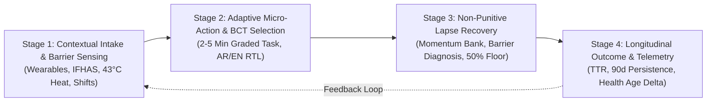

# Khatwa (خطوة) — Abu Dhabi Adaptive Health Behavior Loop Engine
## Workflow Kickoff & Specification Document (`docs/KICKOFF.md`)

---

### 1. Constraints & Submission Checklist (Official 6 Non-Negotiables)
| # | Requirement | Status / Strategy | Evidence / Location |
|---|-------------|-------------------|---------------------|
| 1 | **GitHub repository link** | Target repo configured | `docs/SUBMISSION.md`, git remote tracking |
| 2 | **Public repository access** | Set to PUBLIC prior to deadline | Verified via incognito clone test |
| 3 | **Deployed Project link** | Live web app deployed on port 8080 / public cloud host | Tested in incognito window |
| 4 | **Project Description (~120-150 words)** | Locked narrative on adaptive behavior loop, BCT grounding, anti-punitive recovery, and UAE privacy | `docs/SUBMISSION.md` Section 4 |
| 5 | **Gen AI Services clearly stated & mapped** | Explicit inventory of Gemini 2.5 Flash / Pro and ADK agents mapped to exact files | `docs/GENAI-SERVICES.md` & README.md |
| 6 | **Demo Video link** | 3-minute high-impact walkthrough covering Judge Bar, personas, and attack tests | `docs/SUBMISSION.md` Section 6 |

---

### 2. Abu Dhabi Ecosystem Context
Khatwa bridges fragmented Abu Dhabi health assets into an active, continuous, personalized closed-loop behavioral operating system:
* **IFHAS Screenings (ADPHC)**: Comprehensive cardiovascular, diabetes, and lifestyle risk screenings provide clinical baselines (e.g., HbA1c, blood pressure, fasting glucose).
* **Sahatna App Journeys & Health Age**: Converts static annual Health Age calculations (e.g., chronological age 42 vs. Health Age 46) into dynamic weekly trajectory micro-gains.
* **Malaffi Health Information Exchange (HIE)**: Ingests clinical risk flags, medication boundaries, and mobility constraints (e.g., bilateral knee osteoarthritis) under strict consent without ever exposing lifestyle or lapse logs back to clinical EHRs or payers.
* **IoT & Wearable Streams**: Continuous passive tracking of step cadence, sleep fragmentation, and resting heart rate (HR) to sense behavior drop-offs in real time.
* **Environmental & Cultural Dynamics**: Live contextual adaptation to Abu Dhabi summer heat (>38°C–44°C), daily Islamic prayer times (Fajr to Isha), Ramadan fasting windows, Majlis hospitality dining norms, and industrial shift patterns (e.g., Khalifa Port, Musaffah).

---

### 3. Judging Rubric Alignment (100% Score Architecture)
1. **Adaptive Personal Plans (20%)**: Translates screening biomarkers and live situational constraints (heat, night shifts, joint pain) into 2-to-5-minute micro-actions in English and Modern Standard Arabic (RTL).
2. **Continuous Learning & Non-Punitive Re-engagement (20%)**: Replaces punitive "streaks" with a resilient **Momentum Bank**. Missed days never reset progress to zero; they trigger automatic 50% task downshifting (`BCT 8.7: Graded Tasks`) and barrier diagnosis.
3. **Evidence-Based BCTs with Visible Rationale & Limits (20%)**: Every intervention pairs Michie et al. BCT codes (`BCT 1.1`, `BCT 1.4`, `BCT 2.3`, `BCT 3.1`, `BCT 8.7`, `BCT 11.2`, `BCT 12.1`) with published scientific rationale AND explicit limits/mitigations (e.g., why extrinsic rewards decay after 6–8 weeks and how intrinsic habit stacking takes over).
4. **User Autonomy, Accessibility & Sovereign Privacy Firewall (20%)**: Features Arabic RTL toggle, Low-Literacy Visual Mode, Seated Mobility Mode, 48h Guilt-Free Pause, and deterministic Layer 1–3 guardrails complying with UAE Federal Law No. 2 of 2019 to block HR surveillance and insurer underwriting.
5. **Sustained Longitudinal Outcome Measurement & Equity (20%)**: Tracks meaningful real-world health indicators: 90-Day Persistence Rate, Time-to-Recovery (TTR < 1.5 days), projected Health Age delta, and the Equitable Benefit Index across vulnerable cohorts.

---

### 4. Core System Friction (The Abu Dhabi Gap)
* **The Problem**: Public health awareness campaigns in Abu Dhabi achieve high immediate recognition (>70% `[SOURCED: ADPHC Health Reports]`), but traditional wellness apps suffer an 82% drop-off by Day 30 `[SOURCED: Digital Health Retention Benchmarks]`.
* **Root Cause**: Rigid target goals (e.g., "10,000 outdoor steps/day"), punitive streaks that reset to 0 upon missing a day, lack of heat/cultural accommodations, and fear among employees that health app data could impact insurance premiums or employment reviews.
* **Khatwa Solution**: Lower the micro-action floor to 2–5 minutes, guarantee zero-blame recovery, enforce UAE data sovereignty, and pair habit formation with transparent behavioral science.

---

### 5. Connected 4-Stage Adaptive Loop

---

### 6. Domain Binding (`domain-packs/uae_health.md`)
* **Movement (`MOVEMENT`)**: Heat adaptation (>38°C -> indoor AC walk, mall walking, post-Isha indoor routines); seated upper-body routines for knee osteoarthritis.
* **Nutrition (`NUTRITION`)**: Culturally adapted guidance for Emirati and resident households—Majlis hospitality, family platters, Ramadan hydration, shift-work cafeteria choices with 3-compartment visual plate method (`BCT 12.1`).
* **Sleep (`SLEEP`)**: Circadian anchoring for night-shift workers at Khalifa Port / industrial zones; caffeine cut-off and 10-minute wind-down protocols (`BCT 7.1`).
* **Smoking Cessation (`SMOKING_CESSATION`)**: 3-minute urge surfing protocol, craving delay, trigger unlinking, non-judgmental slip recovery (`BCT 11.2`, `BCT 1.2`).
* **Recovery (`RECOVERY`)**: Post-illness/fatigue pacing, micro-breathing stacked onto daily prayer transitions.

---

### 7. Contract Lock (`20-eval-contract.md`)
All API endpoints (`POST /api/analyze`) and CLI calls (`python -m src.core.cli`) strictly return the standard Result JSON contract with status, telemetry, output, and citations. All 10 eval cases in `eval/test-suite.json` must be evaluated against this schema.

---

### 8. Clock-Time Plan & The One Wow
* **Traditional Wellness App (Punitive & Fragile)**:
  - User misses 4 days due to family wedding and 43°C heat -> *"Streak Lost! Day 0 of 30. You failed your weekly challenge."*
  - Result: Guilt, amygdala threat response, user uninstalls app.
* **Khatwa Adaptive Engine (Empathetic & Resilient)**:
  - User misses 4 days -> *"Momentum Bank Preserved: 18 Active Days Intact. We identified high ambient heat (43°C) and social Majlis commitments."*
  - Automatically activates **BCT 8.7 (Graded Tasks)**: Drops requirement from 8,000 outdoor steps to a 5-minute indoor air-conditioned loop + post-Maghrib hydration stack.
  - Transparently displays scientific rationale and limits: why micro-steps protect habit identity, and when to ramp back up.
